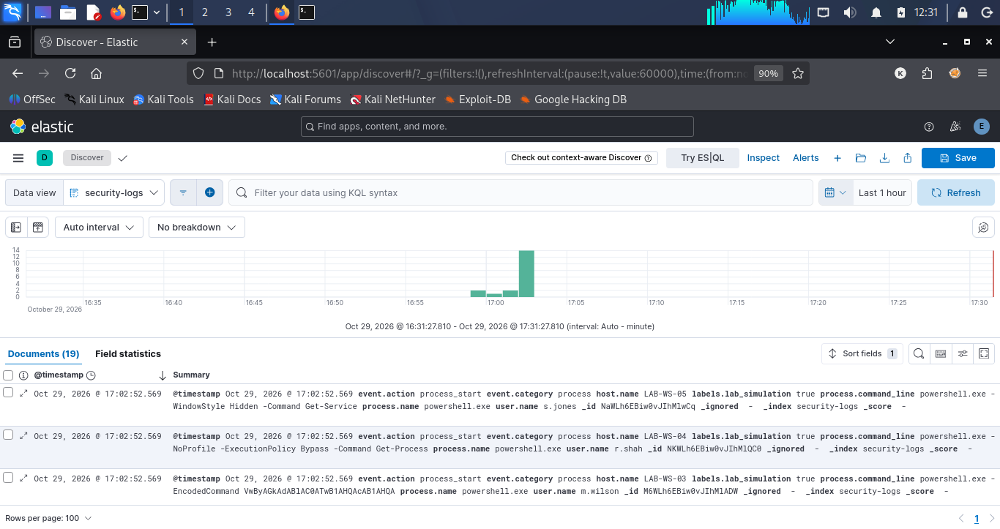
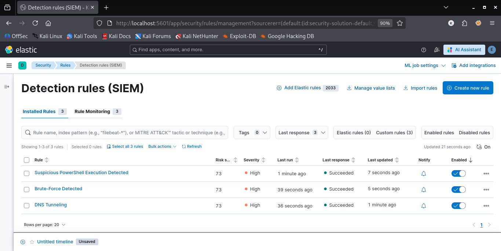
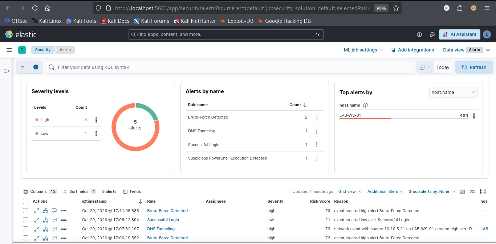

# Develop and Test Custom SIEM Correlation Rules Using ELK Stack

## 1. Objective

The objective of this task was to configure and test custom detection rules using the ELK Stack to identify suspicious security events, including brute-force login attempts, potential DNS tunneling, and suspicious PowerShell execution.

The task helped me understand how SIEM detection rules can identify suspicious activity from indexed security logs and generate alerts for further investigation.

## 2. Lab Environment

| Component          | Details         |
| ------------------ | --------------- |
| Operating System   | Kali Linux      |
| SIEM Platform      | ELK Stack       |
| Log Analysis       | Kibana          |
| Search and Storage | Elasticsearch   |
| Log Index          | `security-logs` |

## 3. Lab Setup

I installed and configured Elasticsearch and Kibana on Kali Linux. I created the `security-logs` index to store security events and used Kibana to search and analyze the indexed data.

I then configured three custom detection rules for suspicious authentication failures, potentially suspicious DNS queries, and suspicious PowerShell commands.

### Log Analysis Workflow

Kali Linux → Elasticsearch → `security-logs` → Kibana Detection Rules → Alerts → Investigation

## 4. Detection Rule 1: Brute-Force Detection

### Rule Configuration

| Setting              | Value                                                           |
| -------------------- | --------------------------------------------------------------- |
| Rule Name            | Brute-Force Detected                                            |
| Index                | `security-logs`                                                 |
| Rule Type            | Threshold                                                       |
| KQL Query            | `event.category: "authentication" AND event.outcome: "failure"` |
| Group By             | `source.ip.keyword`                                             |
| Threshold            | 5 events                                                        |
| Runs Every           | 5 minutes                                                       |
| Additional Look-back | 6 minutes                                                       |
| Severity             | High                                                            |
| Risk Score           | 73                                                              |
| MITRE ATT&CK         | T1110 – Brute Force                                             |

### Purpose&#x20;

This rule identifies repeated authentication failures that may indicate brute-force activity. It groups matching events by source IP and triggers when the configured threshold is reached.

### Testing and Expected Result

Five or more matching authentication failures from the same source IP within the configured time window should meet the threshold.

Repeated failures alone do not prove a successful attack, so the source IP, timestamps, affected account, and any subsequent successful logins should be investigated.

## 5. Detection Rule 2: Potential DNS Tunneling

### Rule Configuration

| Setting              | Value                                                                         |
| -------------------- | ----------------------------------------------------------------------------- |
| Rule Name            | DNS Tunneling                                                                 |
| Index                | `security-logs`                                                               |
| Rule Type            | Custom Query                                                                  |
| KQL Query            | `network.protocol: "dns" AND dns.question.type: ("TXT" OR "NULL" OR "CNAME")` |
| Runs Every           | 5 minutes                                                                     |
| Additional Look-back | 6 minutes                                                                     |
| Severity             | High                                                                          |
| Risk Score           | 73                                                                            |
| MITRE ATT&CK         | T1071.004 – DNS                                                               |

### Purpose

This rule searches for DNS events using selected record types that may be relevant during a DNS tunneling investigation.

### Testing and Expected Result

I used a controlled DNS test event to validate whether the query matched the indexed data. Matching events can be investigated for unusual query frequency, long or encoded subdomains, suspicious destinations, and unexpected DNS activity.

TXT, NULL, or CNAME records alone do not confirm DNS tunneling. Additional evidence is required to determine whether the activity is malicious.

## 6. Detection Rule 3: Suspicious PowerShell Execution

### Rule Configuration

| Setting              | Value                                    |
| -------------------- | ---------------------------------------- |
| Rule Name            | Suspicious PowerShell Execution Detected |
| Index                | `security-logs`                          |
| Rule Type            | Custom Query                             |
| Runs Every           | 5 minutes                                |
| Additional Look-back | 6 minutes                                |
| Severity             | High                                     |
| Risk Score           | 73                                       |
| MITRE ATT&CK         | T1059.001 – PowerShell                   |

### KQL Query

```kql
process.name: "powershell.exe" AND process.command_line: (*bypass* OR *hidden* OR *iex* OR *downloadstring* OR *encodedcommand*)
```

### Purpose

This rule searches for PowerShell process events containing command-line patterns that may be associated with suspicious execution, encoded commands, hidden execution, or download activity.

### Testing and Expected Result

I used a controlled PowerShell test event to validate the query against the indexed logs. Matching events should be investigated by reviewing the complete command line, parent process, user account, endpoint, and related network activity.

These command-line patterns are investigation indicators and may also appear in legitimate administrative activity.


## 7. Evidence and Screenshots

### Screenshot 1: Security Logs Index



This screenshot should show the Elasticsearch `security-logs` index and its indexed documents.


### Screenshot 2: Detection Rules



This screenshot should show all three detection rules and their enabled status.


### Screenshot 3: Generated Alerts



This screenshot should show the actual generated alerts, including rule names and timestamps. Include severity when available.

##

## 8. Conclusion

I worked on configuring and testing three custom SIEM detection rules using the ELK Stack. The rules were designed to identify repeated authentication failures, potentially suspicious DNS activity, and suspicious PowerShell execution.

This task strengthened my practical understanding of security log analysis, detection engineering, KQL, and SIEM alert investigation. The final validation results are documented using screenshots from my own lab environment.
