# HawkEye Lab: Network Traffic Analysis

## 1. Objective

The objective of this lab was to investigate the HawkEye challenge from CyberDefenders by analyzing network traffic, identifying suspicious activities, and extracting important information from the captured packets.

## 2. Lab Setup

1. Opened CyberDefenders – Blue Team CTF Challenges.
2. Created an account and logged in.
3. Opened the HawkEye Lab and downloaded the challenge file.
4. Extracted the downloaded archive.
5. Opened the `stealer.pcap` file in Wireshark for network traffic analysis.

## 3. Tools Used

- **Wireshark:** Analyzed network packets, DNS queries, HTTP traffic, and SMTP communication.
- **CyberChef:** Decoded Base64 data and analyzed encoded information.
- **macvendors.com:** Identified the manufacturer of a network interface card (NIC).
- **AbuseIPDB / IP Lookup:** Checked IP address information and geolocation.

## 4. Lab Investigation and Findings

### Q1. How many packets does the capture have?

**Answer:** `4003`

**Analysis:** Statistics → Capture File Properties → Checked the total packet count.

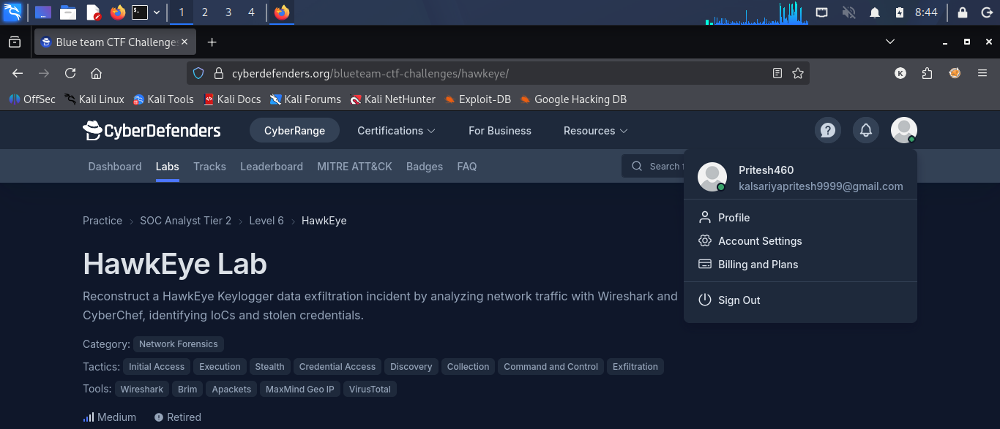

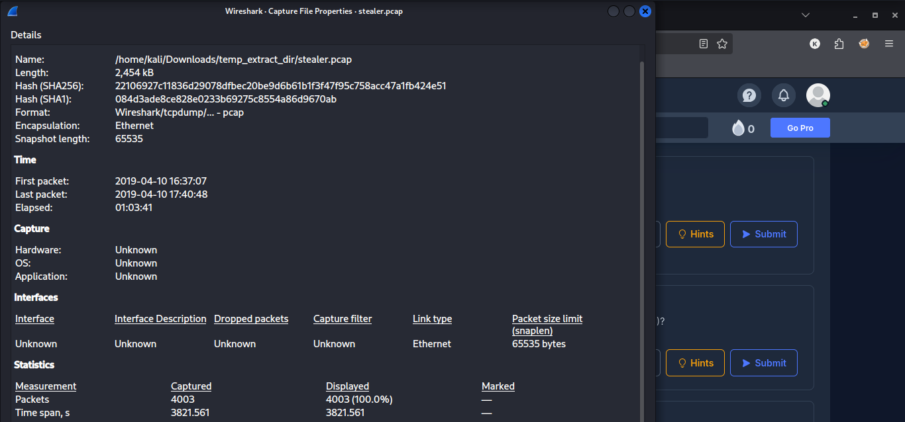

### Q2. At what time was the first packet captured (UTC)?

**Answer:** `2019-04-10 20:37`

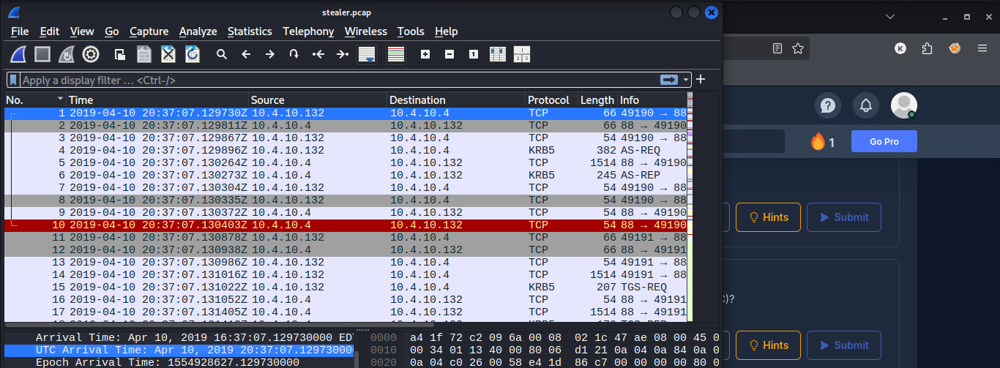

### Q3. What is the duration of the capture?

**Answer:** `01:03:41`

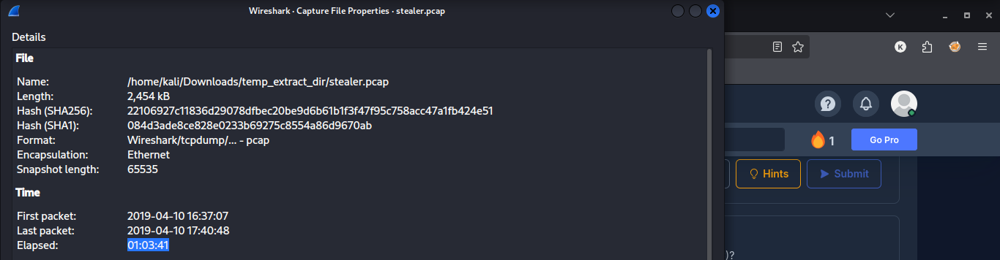

### Q4. What is the most active computer at the link level?

**Answer:** `00:08:02:1c:47:ae`

**Analysis:** Statistics → Conversations → Ethernet → Identified the most active MAC address.

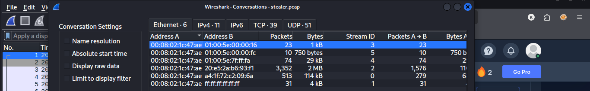

### Q5. Manufacturer of the NIC of the most active system at the link level?

**Answer:** `Hewlett-Packard`

**Analysis:** Opened macvendorlookup.com → Entered the MAC address → Checked the manufacturer.

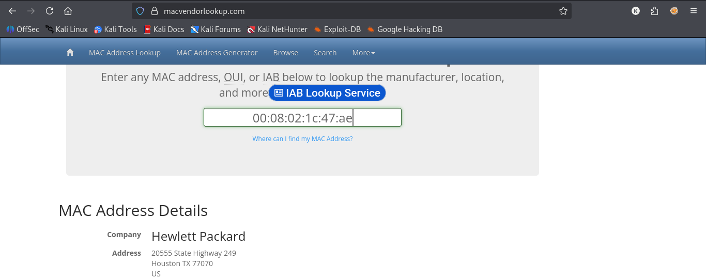

### Q6. Where is the headquarters of the company that manufactured the NIC?

**Answer:** `Palo Alto`

**Analysis:** Searched for Hewlett-Packard headquarters → Checked the location.

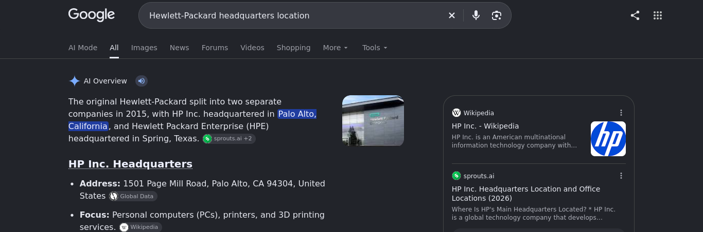

### Q7. The organization works with private addressing and netmask /24. How many computers in the organization are involved in the capture?

**Answer:** `3`

**Analysis:** Statistics → Endpoints → Checked the private IP addresses.

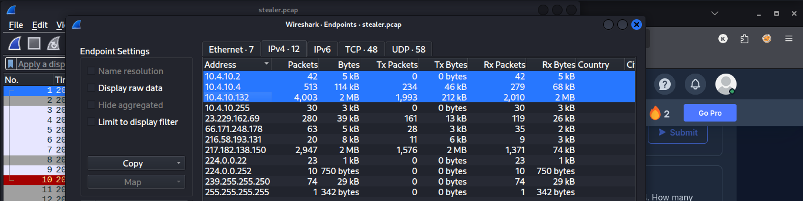

### Q8. What is the name of the most active computer at the network level?

**Answer:** `BEIJING-5CD1-PC`

**Analysis:** Applied the DHCP filter → Checked the DHCP packet details → Identified the hostname.

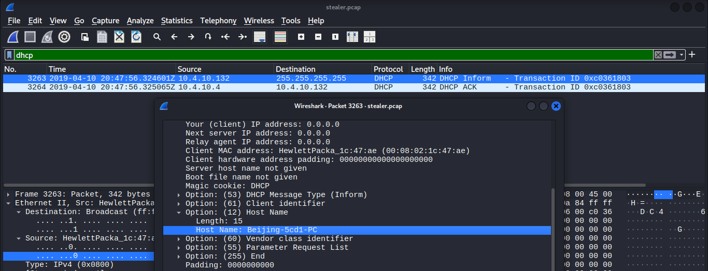

### Q9. What is the IP of the organization's DNS server?

**Answer:** `10.4.10.4`

**Analysis:** Applied the DNS filter → Checked DNS packets → Identified the DNS server IP.

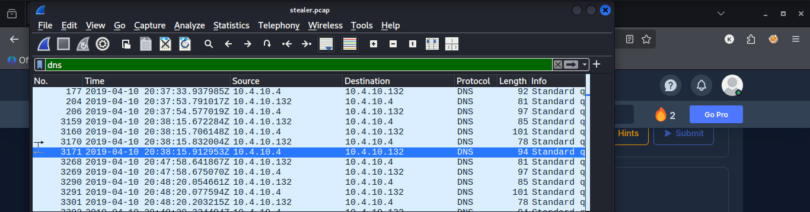

### Q10. What domain is the victim asking about in packet 204?

**Answer:** `proforma-invoices.com`

**Analysis:** Applied the `frame.number == 204` filter → Checked the DNS query → Found the domain name.

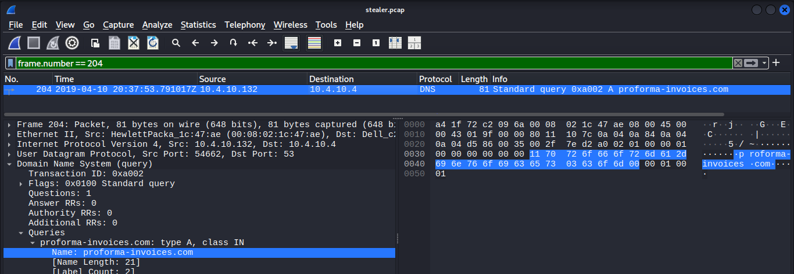

### Q11. What is the IP of the domain in the previous question?

**Answer:** `217.182.138.150`

**Analysis:** Followed the UDP stream → Identified the resolved IP address.

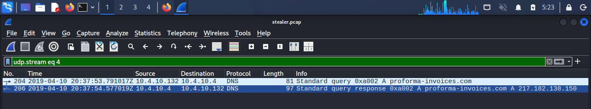

### Q12. Indicate the country to which the IP in the previous question belongs.

**Answer:** `France`

**Analysis:** Opened AbuseIPDB → Entered the IP address → Checked the country.

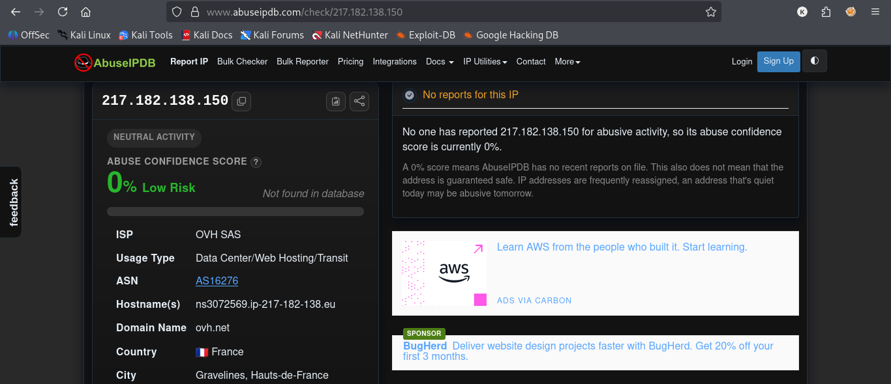

### Q13. What operating system does the victim's computer run?

**Answer:** `Windows NT 6.1`

**Analysis:** Applied the HTTP filter → Checked the User-Agent → Identified the operating system.

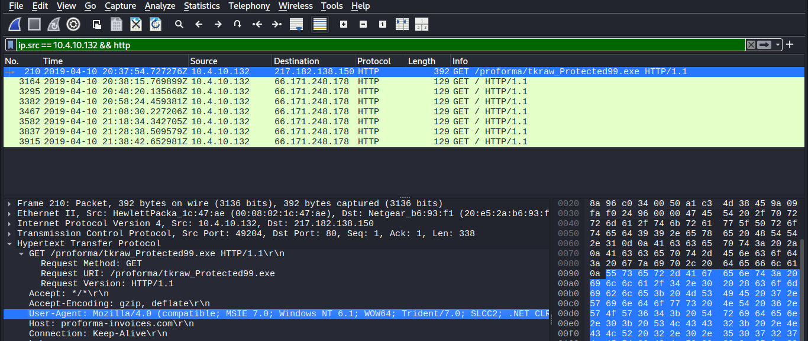

### Q14. What is the name of the malicious file downloaded by the accountant?

**Answer:** `tkraw_Protected99.exe`

**Analysis:** File → Export Objects → HTTP → Found the downloaded executable.

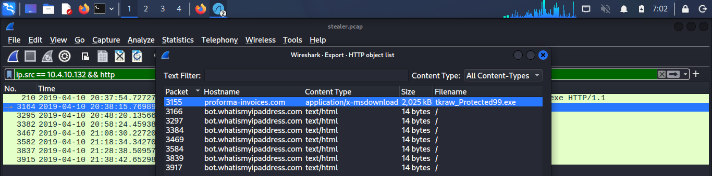

### Q15. What is the MD5 hash of the downloaded file?

**Answer:** `71826ba081e303866ce2a2534491a2f7`

**Analysis:** Used the terminal `md5sum` command → Calculated the MD5 hash.

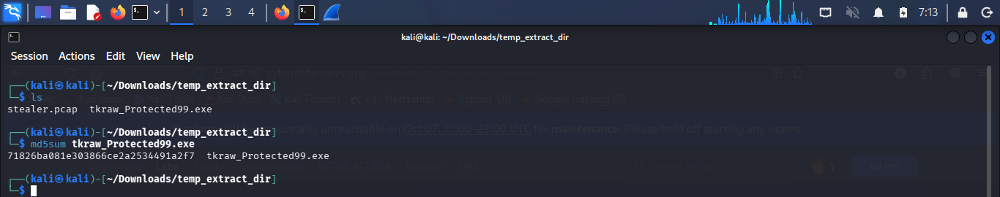

### Q16. What software runs the web server that hosts the malware?

**Answer:** `LiteSpeed`

**Analysis:** Applied the `http.response` filter → Checked the response headers → Identified the server software.

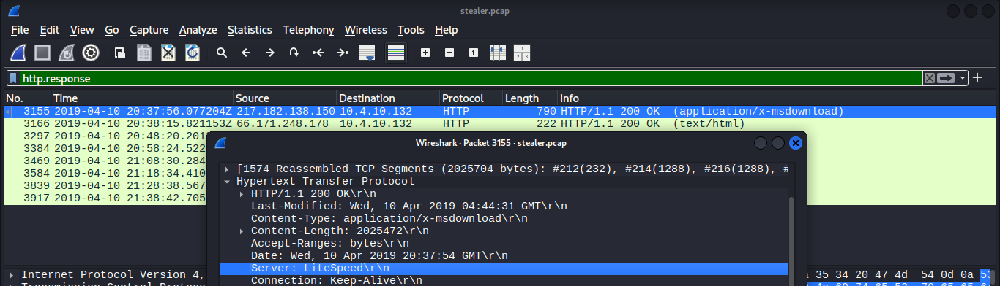

### Q17. What is the public IP of the victim's computer?

**Answer:** `173.66.146.112`

**Analysis:** Checked HTTP response traffic → Followed the HTTP stream → Found the public IP address.

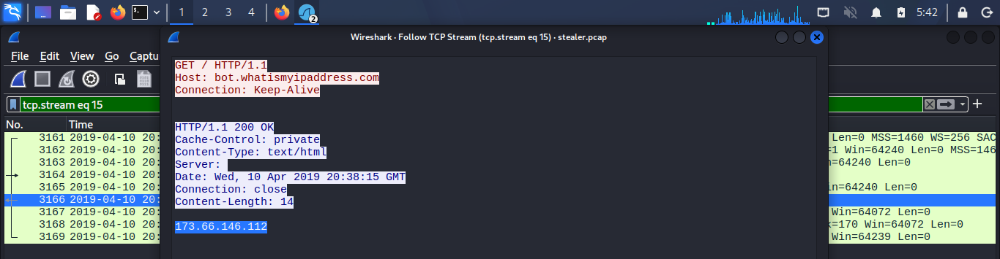

### Q18. In which country is the email server to which the stolen information is sent?

**Answer:** `United States`

**Analysis:** Applied the SMTP filter → Identified the email server IP → Checked the country using AbuseIPDB.

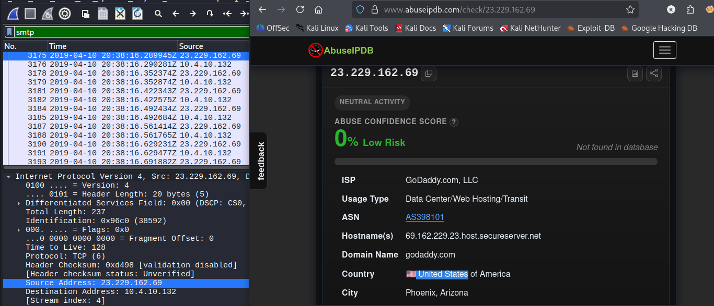

### Q19. Analyzing the first extraction of information. What software runs the email server to which the stolen data is sent?

**Answer:** `Exim 4.91`

**Analysis:** Applied the SMTP filter → Followed the TCP stream → Checked the SMTP server response.

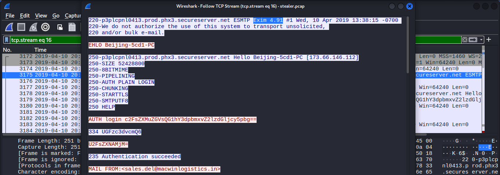

### Q20. To which email account is the stolen information sent?

**Answer:** `sales.del@macwinlogistics.in`

**Analysis:** Followed the SMTP TCP stream → Checked the recipient email address.

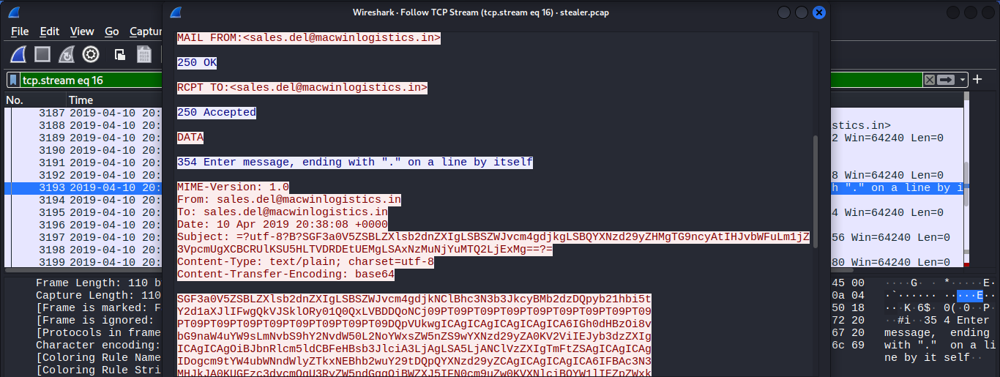

### Q21. What is the password used by the malware to send the email?

**Answer:** `Sales@23`

**Analysis:** Followed the TCP stream → Decoded Base64 authentication data using CyberChef.

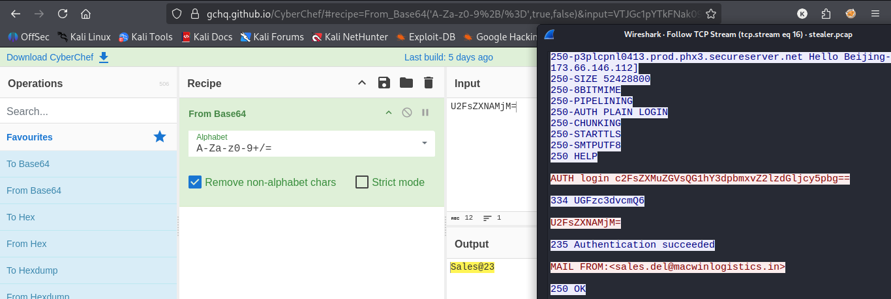

### Q22. Which malware variant exfiltrated the data?

**Answer:** `Reborn v9`

**Analysis:** Followed the TCP stream → Decoded Base64 email content using CyberChef → Identified the malware variant.

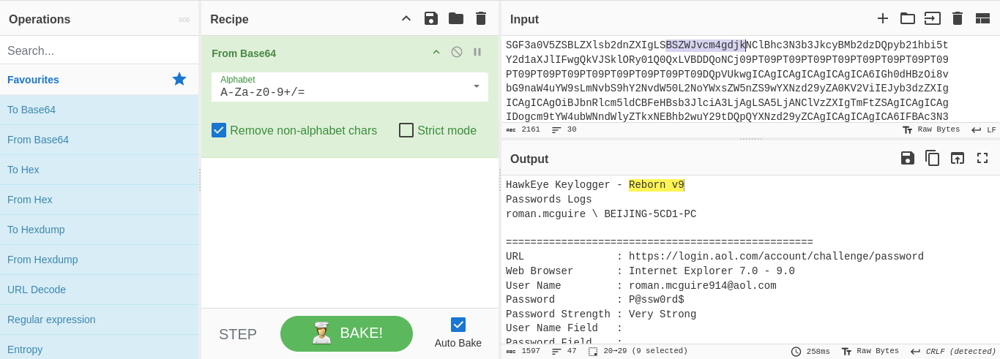

### Q23. What are the Bank of America access credentials? (username:password)

**Answer:** `roman.mcguire:P@ssw0rd$`

**Analysis:** Followed the TCP stream → Decoded email content → Examined the Bank of America data → Found the access credentials.

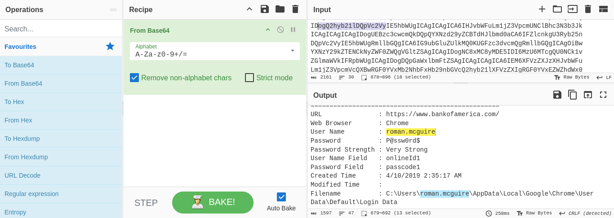

### Q24. Every how many minutes does the collected data get exfiltrated?

**Answer:** `10 minutes`

**Analysis:** Applied the `smtp.response.code == 220` filter → Checked SMTP packet timestamps → Compared the intervals.

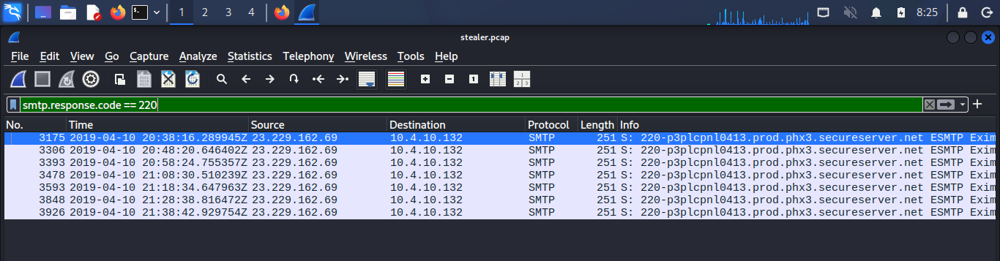

## 5. Conclusion

I completed the HawkEye Lab by analyzing the provided PCAP file in Wireshark and using CyberChef to decode encoded data.

I identified the network devices, DNS information, suspicious domain, downloaded executable, email server details, and evidence of credential theft. I also identified the Reborn v9 malware variant and determined that the collected information was sent approximately every 10 minutes.