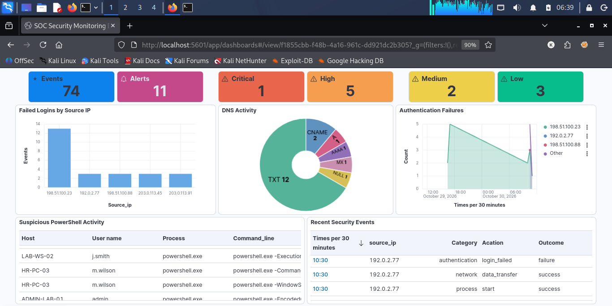

# Custom SIEM Dashboard Using ELK Stack

## 1. Objective

The objective of this task was to design and implement a custom SIEM dashboard using the ELK Stack (Elasticsearch and Kibana). The dashboard provides a centralized view of important security events, helping security analysts monitor and investigate suspicious activities.

It focuses on monitoring failed login attempts, DNS activity, suspicious PowerShell execution, and detection alerts. The goal is to improve security visibility and make it easier to identify unusual activities through visualizations.

## 2. Tools & Environment

- OS: Kali Linux
- Elasticsearch: 8.19.23
- Kibana: 8.19.23
- Data View: `security-logs`
- Visualization: Kibana Lens

## 3. Dashboard Implementation

Created a custom **SOC Security Monitoring Dashboard** in Kibana with the following panels:

**Security Overview**

- Total Security Events
- Total Alerts
- Critical, High, Medium, and Low Alerts

**Security Activity**

- Failed Logins by Source IP
- DNS Activity
- Authentication Failures Over Time

**Threat Investigation**

- Suspicious PowerShell Activity
- Recent Security Events

## 4. Testing & Results

- Verified security events in Elasticsearch.
- Visualized authentication failures and DNS activity.
- Monitored suspicious PowerShell execution.
- Displayed security metrics and detection alert counts in Kibana.

## 5. Dashboard Screenshot

## 6. Conclusion

Successfully designed and implemented a custom SOC Security Monitoring Dashboard using Elasticsearch and Kibana. Created multiple visualizations to display security events, authentication failures, DNS queries, suspicious PowerShell activity, and alert severity counts.

This task provided practical experience in SIEM dashboard development, security event monitoring, data visualization, and basic threat investigation. It also improved my understanding of how SIEM tools help SOC analysts monitor and analyze security events.
